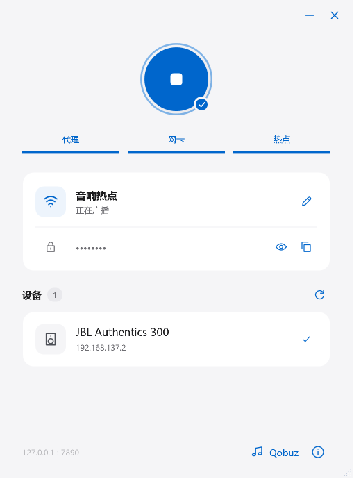

<p align="center"></p>
<h1 align="center">SLink</h1>
<p align="center">Share a local SOCKS5 proxy with devices on your Windows Wi-Fi hotspot.</p>
<p align="center"><a href="README.md">简体中文</a> · English</p>

SLink is a native Windows desktop utility for devices that cannot easily configure a proxy, with a focus on JBL speakers and Qobuz Connect. It connects Windows Mobile Hotspot to an independent virtual adapter backed by your existing local SOCKS5 proxy.

<p align="center"></p>

The screenshot shows the actual interface in preview mode with sample data. The application UI is currently Simplified Chinese.

## Download

Download `SLink-<version>-Setup-x64.exe` from the **[latest release](https://github.com/ChrisDong-THU/SLink/releases/latest)**. Releases also include SHA-256 checksums, project source and the corresponding MSYS2 runtime source.

Requirements: Windows 10 2004 (build 19041) or later / Windows 11, x64, .NET Framework 4.8, a Wi-Fi adapter supporting Mobile Hotspot, and administrator privileges. Provide an unauthenticated SOCKS5 proxy on `127.0.0.1`; the default port is `7890` and can be changed or detected automatically.

Installers are currently unsigned. Verify the repository and compare the output of `Get-FileHash .\SLink-1.2.0-Setup-x64.exe -Algorithm SHA256` with the release checksum before installation.

## Use

1. Start your SOCKS5 client and verify that it can reach Qobuz. If using Clash, disable its own TUN mode.
2. Open SLink, allow elevation and confirm the proxy port.
3. Start the connection and wait for the proxy, adapter and hotspot stages to finish.
4. Connect both the speaker and controlling phone to the displayed hotspot, then select the speaker in Qobuz.
5. Stop the connection when finished. Closing the window hides it to the tray; the tray's quit command cleans up the session and exits.

SLink provides no proxy subscription, upstream server or Qobuz account. A ready hotspot indicates successful forwarding probes, not an established speaker playback session. Hardware, VPNs, firewall policy and service availability can affect connectivity.

## Features

- One-click adapter and hotspot lifecycle with per-stage status.
- Hotspot credentials, connected devices and device aliases.
- SOCKS5 port detection and diagnostic export.
- Speaker address-change notices and user-triggered Qobuz restart.
- Bounded hotspot repair after repeated failures.
- Session ownership tracking for cleanup, recovery and upgrades.

```text
Speaker / phone → Windows hotspot / ICS → SLink adapter
                → HEV Socks5 Tunnel → Local SOCKS5 proxy → Internet
```

The application preserves the host's preferred route and system proxy and does not rewrite Clash configuration. It uses C# / WPF on .NET Framework 4.8, HEV Socks5 Tunnel and Wintun.

## Build

Run on Windows x64 with Windows PowerShell 5.1:

```powershell
git clone https://github.com/ChrisDong-THU/SLink.git
cd SLink
powershell -NoProfile -ExecutionPolicy Bypass -File .\build.ps1
powershell -NoProfile -ExecutionPolicy Bypass -File .\tests\run.ps1
```

Output: `artifacts/app/`. No NuGet restore or extra .NET SDK is required. Tests use isolated data, mocks and a loopback socket; they do not change the real network. Inno Setup is required only for building the installer.

See [development](docs/development.md), [architecture](docs/architecture.md), [troubleshooting](docs/troubleshooting.md), [release instructions](docs/releasing.md), and [contributing](CONTRIBUTING.md) (currently in Chinese). Security reports follow [SECURITY.md](SECURITY.md).

## License

SLink source is distributed under [GPL-3.0](LICENSE). Bundled dependencies retain their own licenses; see [THIRD_PARTY.md](THIRD_PARTY.md) for provenance and corresponding source. This is an independent project, not affiliated with JBL, Qobuz, Clash or WireGuard.
